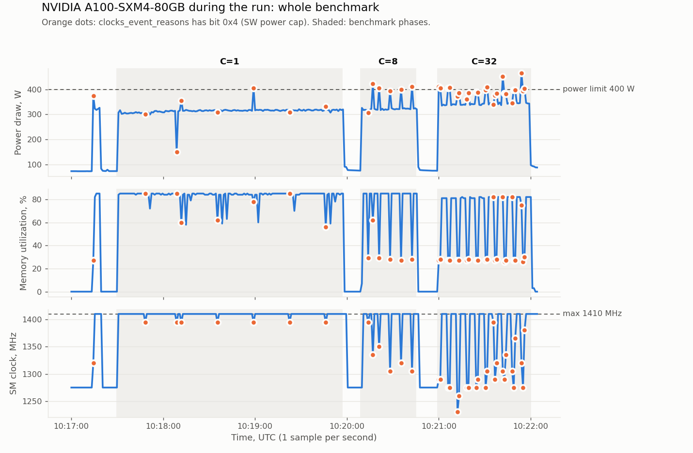
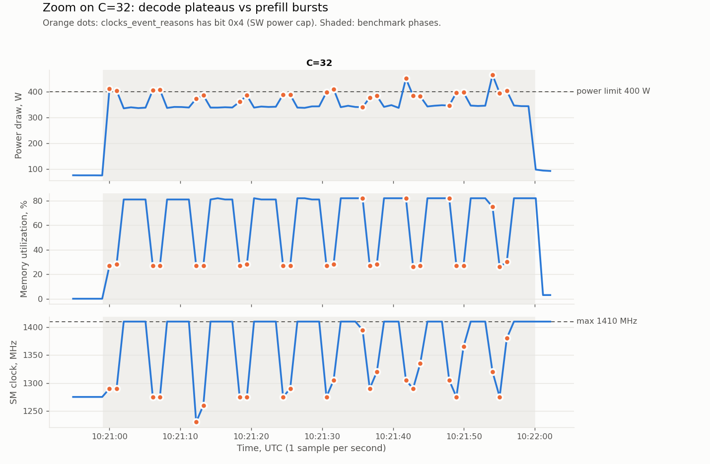

# first-number: qwen3-8b on NVIDIA A100-SXM4-80GB

- Date: 2026-10-25
- Run group: `20261025T101616Z_qwen3-8b_0798e2f`
- Commit: `0798e2fa13d4` (dirty: False)
- Status: final

## Question
How do output throughput, latency and $/1M output tokens of untuned vLLM 0.32
(Qwen3-8B BF16, 1x A100 80GB SXM, 1024 in / 256 out) change from concurrency
1 to 8 to 32, and is decode at C=1 bound by HBM bandwidth?

## Hypothesis
Pre-registered in commit 701e889 (`experiments/2026-10-25-first-number.hypothesis.md`).

- Date written: 2026-10-25 (before the run)
- Config: `configs/qwen3-8b-bf16.yaml`
- Inputs for the estimates: Qwen3-8B config.json (36 layers, 8 KV heads, head_dim 128,
  BF16, 8.2B params); Vast host hwcheck 2026-10-22 (HBM 1766 GB/s, BF16 GEMM 265 TFLOPS);
  price $1.114/h; 1024 in / 256 out tokens.

Model: decode is memory-bound (weights 16.4 GB read once per step, shared by all
requests in the batch); prefill is compute-bound (2 x 8.2e9 x 1024 = 16.8 TFLOP per
request, ~90 ms at an assumed 65% of measured GEMM). Per closed-loop cycle:
time = C x T_prefill + 255 x T_step(C); KV cache = 144 KB/token.

| C | TTFT p50 | TPOT p50 | Out tok/s | $/1M out | Prefill share of GPU time |
|---|---|---|---|---|---|
| 1 | ~100 ms (80-120) | ~11 ms | ~88 | ~$3.5 | ~3% |
| 8 | ~150 ms | ~14 ms | ~540 (500-650) | ~$0.57 | ~19% |
| 32 | ~0.2-0.8 s | ~20-25 ms | ~1300 (1100-1600) | ~$0.24 | ~47% |

- C=1: TPOT floor 9.3 ms at measured 1766 GB/s (8.0 ms at spec 2039 GB/s);
  expect ~85% of measured bandwidth.
- C=8 -> C=32: throughput grows ~2.4x, not 4x: decode is shared across the batch,
  prefill FLOPs are per token and grow linearly with C.
- TPOT in the table is vLLM's measured TPOT = (E2E - TTFT) / (output_tokens - 1):
  it includes other requests' prefill chunks mixed into decode steps.
  The cycle formula uses the pure decode step instead.
  TPOT ~= T_step + (C - 1) x T_prefill / 255:
  C=8: 12 + 7 x 90 / 255 = ~14 ms; C=32: 13 + 31 x 90 / 255 = ~24 ms.
  Plugging TPOT into the cycle formula would count prefill twice.
- C=32 TTFT p95 ~1.5-3 s: all 32 requests start at once (32 x 1024 tokens, prefilled
  in ~4 chunks of 8192 tokens), the first wave is 10% of 320 requests.
- C=32 total throughput ~6600 tok/s = ~63% of the compute ceiling
  (~10,500 tok/s at 172 TFLOPS effective), MFU ~35% of spec 312 TFLOPS; C=1 MFU ~2%.

Checks:
- total_throughput / output_throughput = 1280 / 256 = 5.0 at every C.
- `GPU KV cache size` in server.log ~350k tokens
  (80 GB x 0.90 - 16.4 GB weights - a few GB overhead = ~50 GB / 144 KB).

Falsified if: C=1 TPOT < 9 ms (measurement error) or > 20 ms (wrong card,
throttling, eager mode); C=32 output throughput >= 4x C=8 (prefill cheaper than
assumed); total/output ratio != 5.0 (workload not as configured).

## Setup (auto)
| | |
|---|---|
| Provider | vast 57645153, $1.114/h (on-demand), sharing: none |
| GPU | 1x NVIDIA A100-SXM4-80GB (SXM), 81920 MiB, power limit 400 W, driver 595.91.07 |
| Software | vLLM 0.32.0, torch 2.13.0+cu129, CUDA 12.9, image `ghcr.io/vkolupaev/gpu-infra-lab:v0.32.0-cu129-fe18af2` (base `vllm/vllm-openai:v0.32.0-cu129@sha256:bc0445dac61accbf1c3b17fbb524a71eee0b1b32f55ba45952095e3be8991c3f`) |
| Model | `Qwen/Qwen3-8B` @ `b968826d9c46`, precision bfloat16 |
| Engine | max_num_seqs=256, max_num_batched_tokens=8192, max_model_len=4096, gpu_mem_util=0.9, prefix_caching=False |
| Workload | random, 1024 in / 256 out tokens, ignore_eos=True, closed loop (max-concurrency), seed=0 |
| Host | Vast machine 142924, datacenter 125728, 32 vCPU allocated (nproc shows 128) |
| Environment patch | torchcodec uninstalled on the host (cu13 build in cu129 image, libnvrtc.so.13 missing); text-only model, no effect on the measurement |
| Image tag | fe18af2 predates a history rewrite; that commit is not in current history |
| Lab image digest | sha256:55f609f2994f38fb7b9b04e388b26966051c4a39444af38b9c90268d44c10c8c (resolved from tag v0.32.0-cu129-fe18af2 on 2026-10-25; the day-1 push.log is truncated and has no digest, so the tag history is not verified). Records in runs.jsonl carry the tag only. |
| hwcheck on this host | HBM copy 1759 GB/s, BF16 GEMM 265.9 TFLOPS, verdict OK (`hwcheck.json`) |
| GPU monitoring | nvidia-smi, 1 sample/s, raw file `gpu-monitor.csv` |

## Results (auto)
| Concurrency | Out tok/s | Total tok/s | TTFT p50/p95 ms | TPOT p50 ms | E2E p50/p95/p99 ms | $/1M out | $/1M total | n |
|---|---|---|---|---|---|---|---|---|
| 1 | 87 | 434 | 86 / 90 | 11.2 | 2946 / 2951 / 2956* | 3.563 | 0.713 | 50 |
| 8 | 568 | 2839 | 485 / 538 | 12.3 | 3605 / 3621 / 3627* | 0.545 | 0.109 | 80 |
| 32 | 1346 | 6731 | 1334 / 1968 | 18.5 | 6085 / 6328 / 6430 | 0.230 | 0.046 | 320 |

`*` p99 from fewer than 200 requests - treat as approximate max, not a percentile.
$/1M = price_per_hour x gpu_fraction / (throughput x 3600) x 1e6, at 100% utilization of the GPU.

## Sanity check (auto)
Decode floor (weights / peak HBM bandwidth): **8.04 ms/token**. Measured TPOT p50 at concurrency 1: **11.2 ms** -> 72% of peak bandwidth (expect ~60-85%; >100% = measurement error, <40% = investigate).

## Observations
- C=1: p50@TPOT = 11.2 ms, 1.39x the spec floor 8.04 ms (16.4 GB / 2039 GB/s) - 72% of spec
  HBM bandwidth achieved; 1.20x the floor at measured bandwidth (16.4 GB / 1759 GB/s = 9.3 ms) -
  83% of measured bandwidth achieved. Prefill is ~3% of the request:
  p50@TTFT = 86 ms of p50@E2EL = 2946 ms.
- Output throughput: 87 / 568 / 1346 tok/s at C=1/8/32; C=8 -> C=32 grows 2.37x for 4x concurrency.
- total/output throughput = 5.0 at every C (434/87, 2839/568, 6731/1346).
- Requests finish almost together: std@E2EL = 3.1 / 7.9 / 115 ms at C=1/8/32.
  C=8: p95@E2EL - p50@E2EL = 3621 - 3605 = 16 ms -> synchronized waves.
- Wave decomposition (p50@ITL as the pure decode step): C=8 0.485 s prefill + 255 x 12.05 ms
  = 3.56 s vs measured p50@E2EL = 3.605 s; C=32 4 x 0.485 s + 255 x 15.9 ms = 6.00 s vs 6.085 s.
- C=32 TTFT: 4 prefill chunks of 8192 tokens at ~0.49 s -> groups at ~0.49 / 0.98 / 1.47 / 1.96 s,
  mean 1.225 s vs measured mean@TTFT = 1.233 s; last group 1.96 s vs p95@TTFT = 1.968 s.
- server.log: available KV cache memory 54.76 GiB, GPU KV cache size 398,720 tokens -> 144 KiB/token
  = 36 layers x 8 KV heads x 128 x 2 (K, V) x 2 bytes. Hypothesis: ~350k tokens.
- gpu-monitor.csv:
  - utilization.gpu median 100% in every phase (minimum 89% inside C=1).
  - Decode plateaus: utilization.memory 82-85%, power ~315-345 W (median 315 / 321 / 340 W at
    C=1/8/32), SM clock 1410 MHz.
  - C=32: 10 dips, ~6 s apart, 2-3 s of 0x4 samples each: utilization.memory 26-30%, power
    360-464 W, bit 0x4 (SW power cap), SM clock minimum 1230-1290 MHz per dip.
  - Seconds with bit 0x4: 24 of 59 samples in C=32 (41%); 7 of 144 (5%) at C=1, 6 of 35 (17%) at C=8.
  - Max temperature 59 C. Only 0x0, 0x1 and 0x4 seen in clocks_event_reasons: no thermal
    (0x20/0x40) or HW slowdown (0x8) bits.
- C=32: p99@ITL = 41.0 ms vs p50@ITL = 15.9 ms.

Whole run: power, memory utilization and SM clock per second; orange dots are seconds with bit 0x4.

C=32: decode plateaus (memory ~82%, 1410 MHz) alternate with 10 prefill dips under the power cap.

## Interpretation
**What limits speed at C=1.** Prefill is ~3% of the request time (p50@TTFT = 86 ms of
p50@E2EL = 2946 ms), decode 97%. Decode is memory-bound: every step reads all 16.4 GB of weights
for one token, ~1 FLOP per byte, far below the ridge point of this card (265.9 TFLOPS /
1759 GB/s = ~151 FLOP/byte). p50@TPOT = 11.21 ms is 1.20x the memory floor (16.4 GB / 1759 GB/s
= 9.32 ms), i.e. 83% of measured HBM bandwidth achieved, while the compute floor is only
16.4 GFLOP / 265.9 TFLOPS = 0.06 ms. Confirmation: at C=8 the step barely grew (p50@TPOT
11.2 -> 12.3 ms) with 8x more tokens per step.

**Why C=8 -> C=32 gives 2.37x, not 4x.** In a closed loop a wave of C requests lasts E2E and
yields C x 256 output tokens, so throughput = C x 256 / p50@E2EL: 87, 568 (6.5x C=1) and 1346 tok/s
(2.37x C=8). Requests grew 4x, but the wave grew 6.085 / 3.605 = 1.69x: 4 / 1.69 = 2.37.
Decomposition E2E = wave prefill + 255 x p50@ITL (p50@TPOT includes interleaved prefill chunks of
other groups, p50@ITL is the typical pure decode step):

| C | Wave prefill | Decode, 255 x p50@ITL | Sum | Measured p50@E2EL |
|---|---|---|---|---|
| 8 | 1 chunk of 8192 tokens = 0.485 s | 255 x 12.05 ms = 3.07 s | 3.56 s | 3.605 s |
| 32 | 4 chunks x 0.485 s = 1.94 s | 255 x 15.9 ms = 4.06 s | 6.00 s | 6.085 s |

The decomposition matches the measurement within ~2%, so it is not fitted. Wave growth: measured
+2.48 s (6.085 - 3.605); decomposition 1.46 + 0.98 = 2.44 s, ~60% prefill / ~40% decode step.
Wave prefill grew by 1.46 s (exactly 4x): compute-bound work, every token
costs its own FLOPs and there is nothing to share. The decode step got 32% more expensive
(12.05 -> 15.9 ms), +0.98 s per wave: memory-bound work, weights are still read
once for everyone, but **each request has its own KV cache**, and reading it grows linearly with
C: ~1% of the traffic at C=1, ~25% at C=32. Bottom line: batching shares only **weight reads**
between requests; prefill (compute) and KV cache (memory) belong to each request and grow linearly
with C, so output grows slower than the number of requests.

**Why TTFT at C=8 and C=32 is far above the hypothesis.** The client added almost no pauses or
jitter: requests of a wave reach vLLM almost at once, do identical work and finish almost together
(std@E2EL = 7.9 ms at C=8; 3.1 ms at C=1, 115 ms at C=32). Three things keep them synchronized:
`--request-rate inf` (the starting eight go out at once), the closed loop (`--max-concurrency 8`:
a finished request is replaced immediately) and identical work (exactly 1024 in and 256 out
tokens, `ignore_eos`, random dataset without length spread). Hence the cycle: 8 requests start
together, finish together (p95@E2EL - p50@E2EL = 16 ms), the next 8 are sent together, the wave
repeats. vLLM's continuous batching admits a request on any step, but here new requests arrive only
in bursts, once per wave, so the server is forced to behave like static batching: 8 prefills at
once, 255 decode steps, 8 prefills again. Every request waits for the prefill of the whole burst:
p50@TTFT = 485 ms instead of ~86. At C=32 a wave is 32 x 1024 = 32,768 prefill tokens = 4 chunks of
8192, and requests get their first token in four groups of 8 at ~0.49 / 0.98 / 1.47 / 1.96 s: mean
1.225 s vs mean@TTFT = 1.233 s, last group 1.96 s vs p95@TTFT = 1.968 s. The model built on C=8
predicted C=32 TTFT almost exactly. The hypothesis assumed requests desynchronize after the first
wave and the prefill burst happens once; with identical work the synchronization persists and the
burst repeats in **every** wave. Caveat: this is a property of the method (closed loop +
`request-rate inf` + fixed lengths), not of the server, and the worst case for TTFT. In real
traffic requests arrive at random, a newcomer joins the batch alone and TTFT is closer to ~90 ms.
To check: open loop (`--request-rate R`, Block 2.1) or length spread (`--random-range-ratio`).

**What power and bit 0x4 show at C=32.** On the GPU sensors the phases alternate in a strict rhythm:

| | Plateaus | Dips |
|---|---|---|
| utilization.memory | ~82% | ~27% |
| Power | ~340 W | 360-464 W |
| SM clock | 1410 MHz (max) | 1230-1300 MHz |
| clocks_event_reasons | mostly `0x0` | `0x4` |
| Phase | decode, memory-bound | prefill, compute-bound |

There are exactly 10 dips at C=32, about every 6 s, each ~2 s wide: 320 requests / 32 = 10 waves;
p50@E2EL = 6.08 s; wave prefill = 4 chunks x 0.49 s = 1.96 s. This independently confirms the
synchronized-wave model, from the card's own sensors rather than from the vLLM client. At C=8 the
wave prefill is ~0.5 s and 1 Hz sampling does not catch every one; at C=1 prefill (86 ms) is barely
visible. The share of seconds with bit 0x4 is 5% / 17% / 41% at C=1/8/32 (7 of 144, 6 of 35,
24 of 59) and tracks the prefill share of wave time (3% / 13% / 32%, p50@TTFT / p50@E2EL;
C=32: 1.94 / 6.085 s); slightly higher because 1-s sampling counts any second touched by a prefill
burst. The power cap triggers during prefill; decode plateaus stay below the limit. One C=1 sample
with 0x4 at 151 W is unexplained (likely a transition), not interpreted.
`clocks_event_reasons.active` is a bit mask of reasons the driver holds the clock below
max: `0x1` idle, `0x4` SW power cap (software power limit), `0x8` HW slowdown, `0x20`/`0x40`
thermal. Prefill loads the tensor cores, draw exceeds the 400 W limit, and the driver lowers the
clock (1410 -> ~1275 MHz, ~10% of compute) until the average power is back at the limit; single
points above 400 W are instantaneous readings, the driver regulates the average. Conclusions:
1. On this host prefill hits the power limit, decode does not (~320-340 W, headroom to the limit).
   The limit affects TTFT and throughput at high C, not TPOT at low C.
2. The hardware maximum of this card is 500 W (`power_max_limit_w`). On a host with a 500 W limit
   prefill would be faster and the C=32 numbers different. That is why `power_limit_w` is recorded
   in every point: two "A100 80GB" with different limits are different points.
3. Temperature plays no role: max 59 C, no thermal bits.
4. utilization.gpu has a median of 100% in every phase and does not distinguish the phases; memory
   utilization, power and SM clock do.

## What did not work / surprises
- TTFT at C=8/C=32 far above the hypothesis: closed loop + request-rate inf + fixed lengths
  (ignore_eos) keep requests synchronized, every wave starts with a prefill burst - a property of
  the method, not of steady-state serving. Open loop (Block 2.1) will differ.
- Prefill more efficient than assumed (65%): ~62% of measured GEMM at C=1, ~88% in 8192-token
  chunks, using ~13.9 GFLOP/token (embedding is a lookup; lm_head only for the last prefill token;
  `tie_word_embeddings: false` in config.json at the pinned revision, so lm_head is a separate
  0.62B-parameter matrix). With 16.4 GFLOP/token the 8192-token chunk would need ~277 TFLOPS,
  above the measured 265.9 - physically impossible.
- Prefill hits the 400 W power limit on this host (max 500 W).
- Hypothesis TPOT at C=8/C=32 overestimated: prefill is concentrated at the wave start (in TTFT)
  instead of being spread over decode steps.
- Official vLLM v0.32.0-cu129 image ships a cu13 torchcodec build; vllm serve fails at import.
  Tracked upstream in [vllm-project/vllm#63121](https://github.com/vllm-project/vllm/issues/63121);
  the import crash is fixed on main by [#61090](https://github.com/vllm-project/vllm/pull/61090),
  not in v0.32.0.
- bench.py masks a crashed server with ProcessLookupError from os.killpg.

## Context: reference points
650B tokens/month = 650e9 / (730 h x 3600 s) = ~247,000 tokens/s on average. At C=32 total
throughput is 6731 tok/s per GPU: 37 GPUs at 100% utilization, 92 GPUs at 40%; monthly cost at
$1.114/h x 730 h: ~$30,100 and ~$74,800 per month. The plan's 250k tokens/s uses a 30-day month.
Caveat: 1024/256 closed-loop workload, one host,
untuned engine.

## Next
Same run on a different Vast host (variance between hosts) plus C=1 with 200 prompts
(reliable p99). One experiment, one variable.
